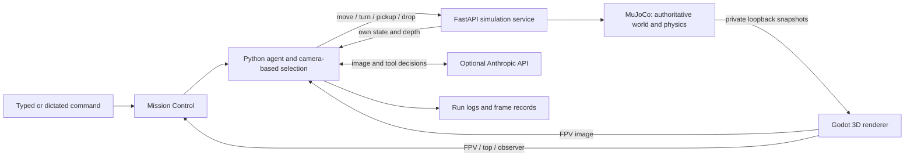

# Haunted Fetch — Camera-Driven Robot Simulation

**Describe an object. Watch a robot inspect the room, identify the right item, pick it up, and deliver it to a marked drop zone.**

Haunted Fetch is an image-driven robotics demonstration built around a **MuJoCo simulation**, a **Godot 3D Halloween environment**, and a **Python vision-and-navigation agent**. A browser dashboard shows the robot camera, its trajectory, and the same room from a cinematic observer view.

The project supports an Anthropic vision-language-model workflow and a free, local computer-vision policy for development. Both use camera observations and the robot's own state; the agent does not receive the simulator's object registry or ground-truth coordinates.

[Quick start](#quick-start) · [Commands](#commands-and-clarification) · [Architecture](#architecture) · [Verification](#verification) · [Limitations](#limitations)

## What the project solves

A natural-language fetch task requires more than matching a colour. Two items can share a colour or shape; an object farther away can look smaller despite being physically taller; an obstacle can block the direct route to the delivery area.

Haunted Fetch combines:

- **Camera-based object recognition:** colour, primitive shape, and estimated physical dimensions.
- **Clarification before action:** an ambiguous request stops for a more specific description instead of silently selecting the nearest match.
- **Navigation with observed obstacles:** calibrated geometry, collision-aware planning, and alternative approaches to the drop zone.
- **One simulation, three synchronized views:** the audience can inspect what the robot sees, where it travels, and what happens in the room.
- **Reviewable execution:** action reasons, camera frames, physics telemetry, and delivery outcomes are recorded.

The distinguishing feature is the combination of a camera-driven task and transparent observation of the same authoritative simulation. The Halloween environment makes the demonstration visually distinctive; it is not a claim of superior model accuracy.

## Features

| Area | Current functionality |
|---|---|
| 3D environment | Purple paneled walls, tiled floor, webs, bats, pumpkins and an enlarged orange robot with visible grippers |
| Shared scene | MuJoCo owns motion and interactions; Godot renders the resulting state |
| Robot camera | 640×480 JPEG, 90° horizontal field of view; visible arms and held-object animation |
| Top view | 1012×760 orthographic view with the robot's actual trajectory; manual dot annotations have been removed |
| Live observer | 1440×1080 cinematic room view |
| Dashboard | White background, black text and controls, readable system fonts, activity log and physics readout |
| Fullscreen | Individual FPV/observer controls, plus **All views fullscreen** for three views side by side with logs below |
| Voice entry | **Dictate** transcribes into the command box; review the text, then press Enter or Run agent |
| Target selection | Colour/shape descriptions, size adjectives, tallest/shortest and other supported comparisons |
| Ambiguity handling | Full in-place camera sweep followed by clarification when multiple matching objects remain |
| Delivery challenges | Clear, horizontal-front, left-open, right-open and fully enclosed barrier scenarios |
| Timing | 30 FPS rendering/recording target with 250 Hz physics integration |
| Validation | Python regression tests, JavaScript interaction tests, renderer checks, and run/clip audits |

The fixed demo contains two equally sized cubes in different colours, one tall cone and two spheres. The scene generator also supports cylinders and randomized arrangements of four to six primitives. The six supported scene colours are **red, blue, yellow, purple, orange and teal**.

The shared delivery marker is a **white 1.5 m square with a black skull/skeleton design**, consistent across the three views.

## Quick start

### Prerequisites

- Python **3.13** is the locally tested version.
- **Godot 4.5.1** is the tested renderer. Install the executable separately; it is not included in Git.
- A graphics-capable desktop session for Godot's compatibility renderer.
- Node.js to run the JavaScript interaction tests. The simulation dashboard does not require a React/Vite build.
- An Anthropic API key only if you want the hosted-model path. The mock policy needs no API key.

The documented launcher uses a POSIX shell and has been exercised on macOS. Windows-specific setup and other hardware have not been validated.

### 1. Clone and install Python dependencies

Run from the repository root:

```bash
git clone https://github.com/vashishtpatel2007-tech/L1.git
cd L1
python3.13 -m venv .venv
source .venv/bin/activate
python -m pip install --upgrade pip
python -m pip install mujoco numpy Pillow opencv-python-headless scipy fastapi uvicorn httpx certifi pytest
mkdir -p membrane/.tools
```

This is the simulation's dependency set, independent of the older starter-kit application. It is not a pinned dependency lockfile. The `.tools` directory is required for the local renderer log and is Git-ignored.

### 2. Point the bridge at Godot

On macOS, for a standard application installation:

```bash
export GODOT_BIN="/Applications/Godot.app/Contents/MacOS/Godot"
```

On other systems, set `GODOT_BIN` to the **absolute path of the Godot executable**. If omitted, the bridge looks for `membrane/.tools/Godot.app/Contents/MacOS/Godot`.

### 3. Start the Halloween simulation

```bash
PORT=8082 ./membrane/run_halloween.command
```

Open **http://127.0.0.1:8082/**. The launcher sets the agent's engine URL to the same port. Without `PORT`, the launcher defaults to port 8080.

The equivalent direct command, with the virtual environment active, is:

```bash
cd membrane
MEMBRANE_ENGINE=http://127.0.0.1:8082 \
  python -m uvicorn engine.godot_server:app --host 127.0.0.1 --port 8082
```

Use the **Godot server entry point** for the Halloween dashboard. `engine.server:app` is the original simulation server and does not enable the Halloween presentation bridge.

### 4. Run a task

In the dashboard, choose the mock provider for a free local run, enter a command such as **“Bring the round red object”**, and click **Run agent** or press Enter.

Alternatively, from a second terminal:

```bash
cd L1/membrane
source ../.venv/bin/activate
export MEMBRANE_ENGINE=http://127.0.0.1:8082
python -m agent.loop --provider mock --command "Bring the tallest object" --max-steps 60
```

The agent claims exclusive control during a run. Manual movement is disabled while that lock is active; use **Stop** to end a run before changing the scene.

## Hosted vision model and configuration

To enable the Anthropic path, create the local configuration file if it does not already exist:

```bash
cd membrane
cp -n .env.example .env
chmod 600 .env
```

Edit `membrane/.env` and set `ANTHROPIC_API_KEY` to your own API key. Do not commit it. No API key is required for the local mock policy.

```bash
export MEMBRANE_ENGINE=http://127.0.0.1:8082
python -m agent.loop --provider anthropic \
  --command "Bring the round red object" --max-steps 60 --budget 35
```

The dashboard also offers provider and model selection. Use `--model` to override the configured provider default with a model available to your account. Model access and service availability depend on that account.

| Setting | Purpose |
|---|---|
| `GODOT_BIN` | Absolute path to the Godot executable |
| `PORT` | HTTP port used by `run_halloween.command`; default 8080 |
| `MEMBRANE_ENGINE` | Engine URL used by the agent; set it explicitly for CLI runs on another port |
| `ANTHROPIC_API_KEY` | Hosted vision-model credentials, loaded from the local environment/configuration |
| `--max-steps` | Action budget, capped at 60; scanning turns also count |
| `--budget` | Cumulative API-spend guard; CLI default is $35 |
| `--rpm` | Hosted-model request pacing |

Usage-based API spend is tracked in the ignored `runs/spend.json`. Deterministic local actions do not make model calls. The latest verification did not initiate paid-model evaluations.

## Commands and clarification

Examples depend on the objects actually present in the scene:

| Command | Selection intent |
|---|---|
| “Bring the round red object” | Red sphere |
| “Bring the tallest object” | Greatest estimated physical height |
| “Bring the shortest object” | Smallest estimated physical height |
| “Bring the tall blue object” | Tallest matching blue object |
| “Bring that purple thing” | Purple object, if uniquely identified |
| “Bring the smaller purple cone” | Smaller matching cone by the supported size estimate |
| “Bring the blue cube” | Blue box/cube |

Before selecting a target, the robot makes **eight 45° turns**, surveying all directions without translating. The resolver then examines the accumulated camera detections.

If two purple cones match **“Bring that purple cone”**, the run ends with a clarification message:

> I found 2 matching purple cones. Please be more specific—for example, the taller or smaller one, or add its colour or shape.

The dialog lists the estimated matches. Click **Edit command**, specify the intended object, and start another run. The robot does not move forward or pick up either object before this initial ambiguity check passes.

This rule applies across all six supported colours and the primitive shapes. Close comparison ties, insufficient size measurements, unrecognized descriptions and missing matches also stop with an explanation. A full rotation cannot reveal an object completely hidden behind another surface; the system does not claim perfect scene knowledge.

### Voice input

Click **Dictate**, allow microphone access, and speak. The first transcript replaces the command draft. Stop to review or edit it, then press **Enter** or **Run agent**. Speech alone does not start a task.

Dictation uses the browser's speech-recognition implementation, configured for English (`en-IN`). Support varies; unsupported browsers retain typed input. Permission, microphone, silence and network errors are reported. Some browsers send audio to an online speech service. Microphone hardware and permission flows were not exercised in the final automated checks.

## Dashboard and controls

- **Robot camera:** the same observation image available to the agent, enlarged to fill its panel width without stretching object proportions.
- **Activity log:** actions, stated reasons and results beside the camera.
- **Top view & trajectory:** a shorter overhead panel showing the actual robot path. Click-to-add numbered dots and double-click annotations are removed.
- **Haunted room:** a larger live observer panel for inspecting the room, grippers and held object.
- **All views fullscreen:** the three existing live panels move into one side-by-side layout, with logs below. **Back to dashboard**, Escape, or browser fullscreen exit restores their original positions.
- **Individual fullscreen:** available for the robot camera and observer.
- **Scene controls:** reset, fixed demo, randomization, playback, manual actions and barrier scenarios.
- **Physics telemetry:** requested and achieved movement, integration timing, position and heading.

The interface is white and black; the simulation imagery retains its Halloween colours and lighting. Fullscreen reuses the existing streams rather than starting a second simulation.

## Architecture



**MuJoCo remains the authority.** It owns scene geometry, robot pose, collisions, pickup/drop, state transitions and simulation time. Godot receives authenticated private loopback snapshots and renders all three views from the same state. It does not independently steer the robot or advance physics.

**The agent reasons from observations.** It receives camera pixels, sanitized robot state, an optional depth ray and its command/history. Colour, shape, position and size estimates in its visual memory come from those pixels.

**Operator diagnostics are separate.** Top/observer images, the scene registry, ground-truth endpoints and enclosure diagnostics are not model inputs. Tool-result allowlists and prompt/log audits enforce the information boundary. Administrative reset/lock operations and final evaluation remain control/test infrastructure rather than navigation observations.

Targeted navigation, perception, physics and timing corrections were made during this project. The underlying MuJoCo authority and provider workflow are retained; the final engine/agent code is not byte-for-byte identical to the original version.

## Physics, perception and route planning

| Parameter | Value or convention |
|---|---|
| Room | 8 m × 8 m |
| Physics timestep | 0.004 s / 250 Hz |
| Movement speed | 1 m/s |
| Turning speed | 90°/s |
| Heading | 0° points along +x; positive turns clockwise from above |
| Camera | 640×480; 90° horizontal FOV; height 0.5 m; pitch 10° down; forward offset 0.18 m |
| Pickup | Within 0.5 m and ±30° of robot heading |
| Collision recovery | Stop, back off 0.1 m, report collision and update retry state |
| Route grid | 10 cm, eight-connected A* with diagonal cost √2 |
| Rendering/recording | 30 FPS target; static frames may be cached |

At this camera resolution and field of view, the focal length is 320 pixels. Horizontal bearing near the image centre follows `atan((u - 320) / 320)`. Camera tilt and the object's ground-contact row provide range; the top ray then estimates physical height. This avoids ranking purely by apparent pixel size. Clipped measurements are excluded from reliable size comparisons.

Routes use inflated obstacle geometry, clear-segment simplification and sampled delivery approaches. Barriers are inferred from camera imagery. The planner searches its discretized route graph; it does not prove a globally shortest continuous path.

Recent protections include consistent target exclusion from approach obstacles, one controller owning a navigator waypoint, retiring a carried object's stale floor track, and stopping repeated failed replans without positional progress. These fixes prevent the specific reproduced turn-loop failures; they do not guarantee success for every scene or model response.

## Partial blockage and complete enclosure

Use the dashboard's barrier selector to load:

1. **Clear drop location**
2. **Horizontal front barrier**
3. **Left approach open**
4. **Right approach open**
5. **Fully enclosed drop location**

A blocked direct path can be approached from another available side. A private diagnostic checks complete enclosure by the configured rectangular barriers. Only that enclosure condition displays **“ERROR — DROP LOCATION BLOCKED.”** The dialog follows the dashboard's white-and-black theme.

An unverified visual route is distinct from full enclosure. A narrow opening may still be unusable by the robot or carried object without being mathematically enclosed on all sides.

## API reference

The agent's simulation interface consists of seven endpoints:

| Method | Endpoint | Purpose |
|---|---|---|
| GET | `/look` | Robot-camera JPEG |
| GET | `/state` | Robot state, x/y, heading, holding flag and retry count |
| GET | `/depth` | Single-ray distance or null |
| POST | `/move` | Move by signed distance |
| POST | `/turn` | Turn by signed degrees |
| POST | `/pickup` | Attempt a grasp |
| POST | `/drop` | Release the held object |

Dashboard/control endpoints include `/admin/agent_run`, `/admin/agent_status`, `/admin/agent_stop`, `/admin/reset`, `/admin/barrier-scenario`, `/admin/drop-access`, `/admin/physics`, `/admin/lock`, `/admin/clip` and `/admin/render-performance`.

The Godot presentation provides `/admin/live/rgb`, `/admin/live/overhead`, `/admin/live/cinematic`, `/admin/overhead` and `/admin/cinematic`. FastAPI's generated reference is available at **http://127.0.0.1:8082/docs** when running on the documented port.

The launcher binds to loopback. This is a local development/operator service, not a production multi-user deployment with public administrative access.

## Verification

From the repository root, with the virtual environment active:

```bash
cd membrane
python -m pytest -q -m "not integration"
node tests/test_all_views.cjs
node tests/test_voice_input.cjs
```

With the engine running and idle:

```bash
MEMBRANE_ENGINE=http://127.0.0.1:8082 python scripts/verify_halloween.py
```

Recorded-run audits are available separately:

```bash
python -m audit.check_leakage ../runs
python -m audit.check_clip ../runs
```

The clip audit requires actual local MP4 files. `scripts/preflight.sh` includes action requests such as pickup, so use it on a disposable idle test scene, not during a live task.

### Recorded verification results

Latest local verification, **5 November 2026**:

- **189 Python tests passed**, with eight live integration tests deselected.
- Fullscreen tests passed for stream reuse, panel restoration, Escape, native/fallback exits and clarification editing.
- Voice-entry tests passed for explicit submission, denied permission, silence, unsupported browsers, locks and late recognition results.
- All three renderer output dimensions and the public observation schema passed checks.
- Active motion measured **60 rendered snapshots in 2.0058 seconds: approximately 29.91 FPS** against the 30 FPS target.
- A rendered camera sweep detected all six supported colours.

| Scenario | Actions | Result |
|---|---:|---|
| Round red object | 19 | Red sphere delivered; zero collisions |
| Tallest object | 23 | Yellow cone delivered; zero collisions |
| Shortest object | 18 | Blue sphere delivered; zero collisions |
| Tall blue object | 22 | Blue cube delivered; zero collisions |
| Two purple cones, ambiguous description | 9 | Eight scan turns, then clarification; no translation or pickup |
| Smaller purple cone | 21 | Correct cone delivered; zero collisions |
| Horizontal front barrier, earlier regression | 23 | Red sphere delivered; zero collisions |
| Left approach only, earlier regression | 51 | Red sphere delivered; zero collisions |
| Right approach only, earlier regression | 24 | Red sphere delivered; zero collisions |

These task runs used the local image-driven policy. The hosted control branch was additionally checked with an offline vision substitute: the target-obstacle regression delivered in 31 actions with zero collisions, and ambiguity stopped before any external model call. These results do **not** constitute a new paid-model benchmark.

See [the final audit](membrane/godot/FINAL_AUDIT.md) for run identifiers, corrections and verification limits. Native browser visual inspection was unavailable because browser automation was disabled in the verification environment.

## Logs and recording

Runs are stored under `runs/run_<id>/`:

- `log.jsonl`: command, actions, reasons, results and final outcome.
- `progress.json`: current phase and progress.
- `frames/`: step-numbered camera captures when generated locally.
- `agent.stdout.log`: dashboard-launched agent output when present.

The recording pipeline produces 1280×720 MP4 at 30 FPS, letterboxing the 4:3 robot view to preserve proportions. Clips are explicitly resampled into the configured 12–18 second window when needed. This changes playback duration; competition acceptance of time compression requires organizer confirmation.

Credentials, the Python environment, local Godot binaries/import caches, frame directories, logs matching ignore rules, spend tracking and root run MP4 files are excluded from Git. Selected JSON run records and regression image fixtures are versioned for review.

## Repository map

```text
membrane/
  agent/                  Language-model loop, selection, perception and navigation
    selection.py          Ambiguity and metric comparison resolution
    perception.py         Camera-based colour/shape/dimension estimates
    copilot.py            Hosted-path navigation safeguards
    firewall.py           Model observation boundary
  engine/                 MuJoCo simulation and FastAPI control service
    godot_server.py       Halloween dashboard and live view routes
    godot_renderer.py     Private snapshot/rendering bridge
    all_views.js          Combined fullscreen and clarification dialog
    voice_input.js        Dictation and explicit submission
  godot/                  Godot scene, procedural room/robot and project settings
  scripts/                Planner, verification and development utilities
  tests/                  Python/JavaScript regressions and camera fixtures
  audit/                  Log leakage and video checks
  run_halloween.command   Simulation launcher
runs/                     Recorded task evidence and local runtime outputs
apps/api/                 Earlier general-purpose FastAPI starter application
apps/web/                 Earlier React/Vite starter frontend
PLAYBOOK/                 Hackathon planning and demonstration notes
```

The older `./setup.sh` and `./dev.sh` scripts belong to the general-purpose starter kit in `apps/`; they are not the Haunted Fetch launcher. Some old training/sample scripts were removed upstream. Use the simulation-specific setup above for this project.

## Troubleshooting

| Symptom | What to check |
|---|---|
| “Godot missing” | Set `GODOT_BIN` to an existing executable; binaries are not included in the repository |
| Renderer fails at startup | Create `membrane/.tools`; inspect `membrane/.tools/godot-renderer.log`; confirm graphics support |
| Agent cannot connect | Match `MEMBRANE_ENGINE` to the server port; ensure the server is running |
| Manual controls disabled | A run owns the control lock; use Stop before editing the scene |
| Old layout or numbered dots remain | Reload the browser tab to replace its cached/in-memory dashboard code |
| Several objects match | Add a shape, colour or distinguishing size to the command |
| Object cannot be verified | Check that the named object is visible and belongs to the supported palette/shapes |
| Dictation unavailable | Use typed input or a browser supporting speech recognition; check microphone permissions |
| Model request fails | Check your local API key, account access, quota and selected model; use mock for offline development |
| Fewer than 30 FPS under load | Inspect renderer performance and graphics load; the target is not a throughput guarantee on every device |

## Limitations

- Artwork is a procedural reconstruction of the supplied references, not an exact photorealistic asset reproduction.
- The robot uses kinematic motion and idealized grasping, not torque-controlled arm manipulation.
- Recognition is calibrated for the supported primitive palette and room lighting. Occlusion, clipping, segmentation errors and pixel noise can affect estimates.
- A full camera rotation does not prove that every hidden object has been discovered.
- Path optimality is limited to the discretized graph and sampled release approaches.
- Complete-enclosure detection is specific to the configured rectangular barriers.
- Rendering targets 30 FPS; performance depends on hardware and concurrent load.
- Tests cover specific scenarios, not every possible layout or future model response. Native browser visual checks and microphone hardware remain unverified in the final audit.
- Compliance with a competition's interpretation of themed scenes, image-derived navigation aids and clip time compression is not certified.

## Further reading

- [Godot integration and rendering details](membrane/godot/README.md)
- [Final verification audit](membrane/godot/FINAL_AUDIT.md)
- [Problem statement and USP analysis](membrane/godot/BRIEF_ANALYSIS.md)
- [Supplied problem statement PDF](membrane_only_track_brief%20%281%29.pdf)
- [Agent observation firewall](membrane/agent/firewall.py)
- [Selection regression tests](membrane/tests/test_selection.py)
